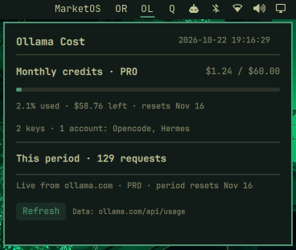

# Ollama Cloud Cost — Omarchy bar widget

A live [Ollama Cloud](https://ollama.com) plan-usage tracker for the Omarchy
status bar. The bar shows the Ollama icon; clicking it opens a dropdown
with how much of your plan's **included usage** you've used this billing
period, the **dollars used and remaining**, the **reset date**, which **API
keys** feed it, and the **request count** for the period.



## Features

- Bar icon:
  - the Ollama mark, in your bar's text colour — working, data is current
  - the Ollama mark in the warning (urgent) colour — the included usage for
    this period is exhausted
  - `⚠` — no API key configured
  - `!` — the last fetch failed (details in the dropdown)
- Dropdown: plan, included usage used (percent and bar), `$ used / $ total`,
  `$ left`, and the reset date
- Billing-period reset date from Ollama (e.g. the 16th), not a calendar month
- Key list: how many keys and accounts feed the numbers, with their labels
- Request count for the current billing period
- Tracks several keys, counting keys that share one account only once
- Auto-refreshes every 5 minutes, on click, and from a Refresh button

## Requirements

- Omarchy (Quickshell-based shell with QML plugin support)
- An [Ollama API key](https://ollama.com/settings/keys) with cloud access
- Python 3 (only for the `update.py` data fetcher; standard library only)
- The `omarchy` icon font with the Ollama glyph (U+E907). It ships with
  Omarchy 4, so there's nothing to install. If your `omarchy` font is older
  and lacks that glyph, the bar falls back to another font and shows an
  unrelated icon (or an empty box) instead of the Ollama mark; the widget
  and dropdown still work.

Tested on Omarchy 4.0.6; 4.5-ready.

## Installation

```bash
curl -fsSL https://raw.githubusercontent.com/neilmc81/omarchy-ollama-cost/main/install.sh | bash
```

The installer:

- clones the plugin to `~/.config/omarchy/plugins/ollama.cost` (or runs
  `git pull --ff-only` if it's already a clone; a symlink or any other
  existing folder is left alone)
- asks for your API key with hidden input (Enter skips) and saves it to
  `~/.config/ollama-cost/conf.json` with mode 600. It doesn't ask if a key is
  already configured (see [Configuration](#configuration)). If
  `OLLAMA_API_KEY` is set, that key is used and isn't written to disk.
- backs up `~/.config/omarchy/shell.json` to `shell.json.bak-<timestamp>` and
  adds `{ "id": "ollama.cost" }` to the bar's right side, unless it's
  already there
- fetches your data once to check the key, then runs `omarchy restart shell`

Options go after `bash -s --`, e.g. `... | bash -s -- --no-restart`:

| Option / env                    | Effect                                        |
|---------------------------------|-----------------------------------------------|
| `--no-register`                 | don't edit `shell.json`; print the snippet    |
| `--no-restart`, `OLLAMA_COST_NO_RESTART=1` | don't restart the shell            |
| `OMARCHY_PLUGINS_DIR`           | plugins directory (default `~/.config/omarchy/plugins`) |
| `OLLAMA_COST_REPO` / `OLLAMA_COST_REF` | clone source and branch/tag (default this repo, `main`) |

### Manual install

The plugin folder **must be named `ollama.cost`** (it matches the plugin id
in `manifest.json`).

```bash
# 1. Clone the plugin into your Omarchy plugins directory
git clone https://github.com/neilmc81/omarchy-ollama-cost \
    ~/.config/omarchy/plugins/ollama.cost

# 2. Add your API key (see "Configuration" for all options), e.g.
mkdir -p ~/.config/ollama-cost
printf '%s\n' '<your-ollama-key>' > ~/.config/ollama-cost/key
chmod 600 ~/.config/ollama-cost/key

# 3. Register the widget in ~/.config/omarchy/shell.json under "bar",
#    e.g. in "layout" → "right":
#      { "id": "ollama.cost" }
#    then reload the shell:
omarchy restart shell
```

## Uninstall

```bash
curl -fsSL https://raw.githubusercontent.com/neilmc81/omarchy-ollama-cost/main/uninstall.sh | bash
```

This removes the widget from `shell.json` (after a backup), the plugin folder
(only if it's an unmodified git clone of this repo; symlinks are left alone),
and the cached data in `$XDG_STATE_HOME/ollama-cost` (default `~/.local/state/ollama-cost`), then restarts the shell.
It asks before deleting your keys in `~/.config/ollama-cost`; the default is
to keep them. `--yes` skips the question and keeps the keys; `--purge`
deletes them. `--no-restart` works as for the installer. `~/.hermes/.env` is
never touched.

## Configuration

Keys are collected from all of these sources (duplicates are ignored):

| Source                                   | Format                                   |
|------------------------------------------|------------------------------------------|
| `$OLLAMA_API_KEY`, `$OLLAMA_KEY`         | one key                                  |
| `~/.config/ollama-cost/conf.json`        | `{"api_key": "..."}` or `{"api_keys": ["...", "..."]}` |
| `~/.config/ollama-cost/key`              | one key on a single line                 |
| `~/.hermes/.env`                         | `OLLAMA_API_KEY=...` (shown as `Hermes`) |

Other optional settings in `conf.json`:

| Key               | Purpose                                                        |
|-------------------|----------------------------------------------------------------|
| `names` (array)   | Display labels for the `api_keys`, in the same order           |
| `monthly_credits` | Fallback grant when `/api/balance` is unavailable (the API value wins) |

```json
{
  "api_keys": ["<key-a>", "<key-b>"],
  "names": ["Laptop", "Agent"]
}
```

Unnamed keys are shown as `key1`, `key2` and so on. If neither `/api/balance`
nor `monthly_credits` gives a grant, the plan's nominal one is used (free 0,
pro $60, max $300, team $1000). Changes are picked up on the next refresh (no
shell restart needed).

### Multiple keys vs. multiple accounts

Ollama reports usage **per account, not per key**: two keys on the same
account return identical numbers. The updater therefore de-dupes by the
account id from `/api/me` and counts each account once; usage is summed only
across genuinely distinct accounts. The dropdown spells it out, e.g.
`2 keys · 1 account: Laptop, Hermes`.

## Security and privacy

- Keys are read only from the environment variables and files listed above,
  and are sent only to `ollama.com`. Nothing is sent anywhere else.
- No key is ever written to the plugin directory, printed, or logged, and no
  part of a key is written to `overview.json`.
- Your account email and account id are stored only in the local state file
  `$XDG_STATE_HOME/ollama-cost/overview.json` (default `~/.local/state/…`).
- The widget does **not** check file permissions. Protect your key files
  yourself:

  ```bash
  chmod 600 ~/.config/ollama-cost/key ~/.config/ollama-cost/conf.json
  ```

## Data source

The widget uses Ollama's own accounting endpoints:

- `GET /api/balance` — the grant, spend and reset for the current billing
  period: `included.allowance_usd` (included credits, e.g. $60 on Pro),
  `included.balance_usd` (credits left) and `included.period.{from,until}`
  (period start and reset). Used = allowance − balance.
- `GET /api/usage?range=30d` — daily usage buckets; the request count sums the
  buckets inside the current billing period.
- `POST /api/me` — plan, email and the account id used for de-duping.

Older plans return a percentage instead of dollars
(`included.weekly.{remaining_percent,resets_at}`). The widget still works
with those: the percentage used and the weekly reset date are correct, but
the remaining percentage is treated as a grant of 100, so the dollar figures
read as percentage points (e.g. `$30.00 / $100.00` means 30% used).

The billing period isn't the calendar month: it resets on a fixed day (for
example the 16th), so the reset date always comes from the API.

## Manual refresh

```bash
python3 ~/.config/omarchy/plugins/ollama.cost/update.py
```

The fetcher writes `$XDG_STATE_HOME/ollama-cost/overview.json` (default `~/.local/state/…`); the widget
watches it and updates live.

## Files

```
manifest.json      plugin metadata
BarWidget.qml      bar icon, 5 min auto-refresh
Panel.qml          click dropdown (plan usage, keys, requests, refresh)
update.py          Ollama data fetcher + multi-key de-dupe
install.sh         one-line installer
uninstall.sh       uninstaller
tests/             unit tests (python3 -m unittest discover -s tests)
```

## License

[MIT](LICENSE)
